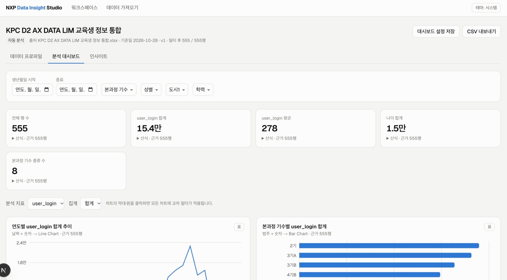

# NXP Data Insight Studio

CSV·XLSX 데이터를 올리면 스키마 인식 → 품질 검사 → KPI·차트 자동 생성 → 근거가 붙은 규칙 기반 인사이트까지 만들어 주는 분석 대시보드입니다. (기술 명세서 v1.0.0 — **Phase 1: Core Dashboard MVP**)

## 실행

```bash
npm install
npm run dev     # http://localhost:3000
npm test        # 엔진 단위 테스트
npm run build
```

첫 화면의 "샘플 데이터로 시작하기"에서 합성 CRM 영업기회 데이터를 바로 추가할 수 있습니다. 샘플은 `scripts/generate-samples.mjs`로 생성한 **합성 데이터**입니다.

## Phase 1 구현 범위

| 명세 항목 | 상태 |
|---|---|
| CSV 업로드 (UTF-8/BOM/EUC-KR, 쉼표·세미콜론·탭 자동 탐지) | 구현 |
| XLSX 업로드 (시트 선택, 헤더 행 지정, 숨김 시트·병합 셀·빈 행 경고, 수식은 저장된 결과만 사용) | 구현 |
| 컬럼 타입·의미 유형(Semantic Type) 추론, 타입 수정 → 원본에서 재정제 + 버전 증가 | 구현 |
| 품질 리포트 (결측, 중복, 고유값, 통계, 날짜 범위, 타입 불일치) / 원본·정제 값 분리 보관 | 구현 |
| 범용 KPI + CRM 템플릿 KPI (명세 산식 그대로, 각 KPI에 산식·근거 행 수 표시) | 구현 |
| 자동 차트 추천 (Line / Multi-line / Bar / Donut / Scatter / Heatmap) + 표 보기 | 구현 |
| 기간·범주 필터, 차트 클릭 교차 필터, 원본 행 Drill-down | 구현 |
| 규칙 기반 인사이트 (집중도, 기간 변화, 품질, 성과 격차, 이상치, 상관) + 임계값 설정 | 구현 |
| 대시보드 설정 저장·복원, 필터 적용 데이터 CSV 내보내기 | 구현 |
| 다크·라이트 테마, 모바일 대응 | 구현 |
| 다중 파일 조인, Neon PostgreSQL, 데이터셋 버전 이력 | Phase 2 |
| REST API / 외부 PostgreSQL Connector, GPT 인사이트, 자연어 질의 | Phase 3 |
| 인증·워크스페이스 격리, 서버 측 검증, 사용량 제한 | Phase 4 |

## 구조

```
src/lib/parsers      CSV·Excel → RawTable
src/lib/analytics    infer · build(프로파일링) · query(집계 엔진) · kpi · charts · insights · templates/crm
src/lib/storage      IndexedDB 저장소 (Phase 2에서 Neon + Vercel Blob으로 교체)
src/components       charts · dashboard · upload · ui
tests/               엔진·파서 테스트 (샘플 CRM KPI를 독립 계산값과 비교)
```

## 이번 작업 요약 (2026-10-28)

**구현**
- Next.js 16 + TypeScript + Tailwind 4 기반 앱 스캐폴딩, Recharts 차트, exceljs/papaparse 파서
- 파서 → 타입·의미 유형 추론 → 품질 프로파일링 → 집계 쿼리 엔진(허용 스키마·사전 정의 집계만 실행) → KPI·차트 추천·인사이트 엔진
- 5개 화면: 워크스페이스, 데이터 가져오기, 데이터 프로파일, 분석 대시보드, 인사이트
- 데이터 가져오기 화면에 예시 데이터 버튼 추가 (업로드와 동일하게 미리보기·타입 수정·품질 리포트를 거쳐 등록)
- Vitest 테스트 18건: 값 파싱, CSV(BOM·구분자), Excel(숨김 시트·병합 셀·수식 결과·헤더 위치), 쿼리 검증, CRM KPI를 독립 계산값과 비교

**오류 수정**
| 문제 | 원인 | 조치 |
|---|---|---|
| UTF-8 BOM 파일이 BOM 없음으로 표시 | `TextDecoder`가 BOM을 자동 제거 | 바이트를 직접 확인 |
| 빌드 실패 (`usePathname` Suspense 오류) | 스캐폴드의 `cacheComponents` 설정 | 클라이언트 중심 앱에 맞지 않아 설정 제거 |
| 'Won이 수주금액의 100%' 인사이트 | 지표 조건이 이미 고정한 차원(`deal_stage`)으로 집중도 계산 | 지표 조건에 쓰인 필드는 차원에서 제외 |
| 10월(28일까지)을 9월과 비교해 -67.8% | 부분 기간을 완전한 기간처럼 비교 | 마지막 부분 기간 제외, 한계 문구에 표시 |
| `close_value` 이상치 22% | Lost 거래의 0값 군집을 IQR이 이상치로 판단 | 비율 10% 초과는 분포 특성으로 보고 제외 |
| KPI가 "3천", "$323.9만"으로 표기 | 한국어 compact 표기를 1만 미만·통화에도 적용 | 1만 미만은 전체 자릿수, 통화는 `$3.2M` 형식 |
| 어색한 조사 ("수주금액가") | 고정 조사 사용 | `이(가)`, `은(는)` 사용 |
| 린트 오류 3건 | 렌더 중 ref 갱신, effect 내 동기 `setState` | 상태 직접 참조, `useSyncExternalStore`로 localStorage 읽기 |
| xlsx 패키지 취약점 경고 | npm `xlsx` 구버전 | `exceljs`로 대체 |

## 바우처 코드 접속

모든 화면(샘플 CSV 포함)은 바우처 코드를 입력해야 접속할 수 있습니다. **초기 코드는 `1234`** 입니다.

- 코드는 서버(`/api/access`)에서 검증하고, 통과하면 서명된 httpOnly 쿠키(7일)를 발급합니다. `src/proxy.ts`가 쿠키가 없거나 위조된 요청을 `/access`로 보냅니다.
- 코드 변경: 환경변수 `VOUCHER_CODES`(쉼표로 여러 개). 코드를 바꾸면 기존 세션이 모두 무효화됩니다.
- 운영 환경에서는 `ACCESS_SECRET`(서명 키)이 **필수**입니다. 없으면 접속이 모두 거부됩니다 (`openssl rand -hex 32`).
- 이 리포지토리는 공개이므로 소스에 적힌 초기 코드 `1234`는 누구나 볼 수 있습니다. 실제 운영 전 `VOUCHER_CODES`로 바꾸세요.
- 이 장치는 접속 제어용 낙관적 검사이며 사용자별 데이터 격리(Phase 4 인증)를 대체하지 않습니다. 접속 시도 횟수 제한은 없고 응답 지연(0.6초)만 있습니다.

## 배포 (Vercel)

Framework Preset은 Next.js, 빌드 명령은 기본값(`next build`)을 사용합니다. 환경변수 `ACCESS_SECRET`을 설정해야 접속이 가능합니다. `VOUCHER_CODES`는 선택입니다.

## 현재 한계

- 모든 처리와 저장이 **브라우저 안**에서 이뤄집니다. 파일은 서버로 전송되지 않으며, 다른 기기·사용자와 공유되지 않습니다.
- 인증과 서버 측 검증이 없으므로 명세의 데이터 격리 기준은 Phase 4 전까지 충족하지 않습니다.
- 대용량 파일은 메인 스레드에서 파싱합니다. 20MB 상한은 임시값이며 성능 측정 후 조정이 필요합니다.
- CRM 템플릿은 `sales_pipeline` 단일 파일 기준입니다. `regional_office` 등 조인이 필요한 차원은 Phase 2에서 추가됩니다.
